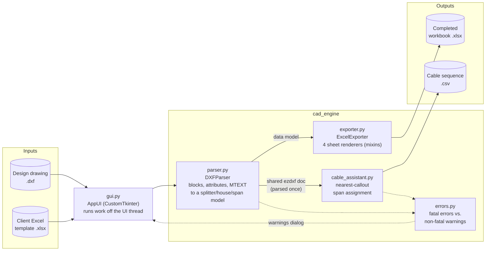
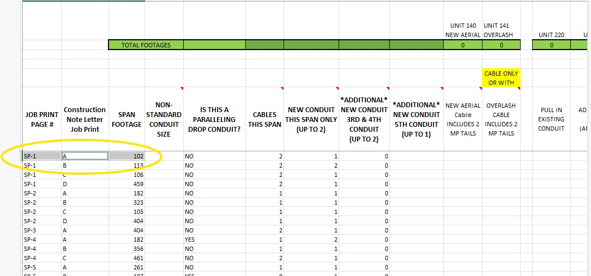
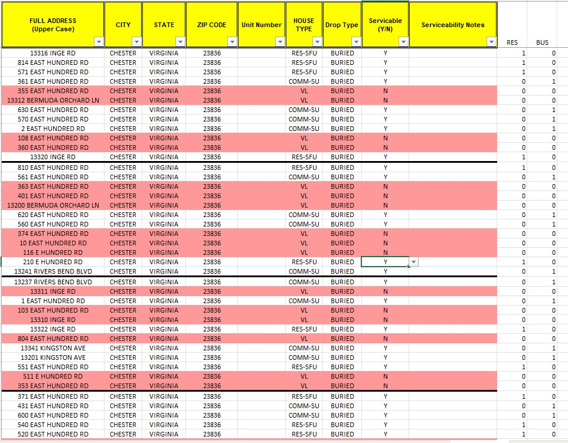
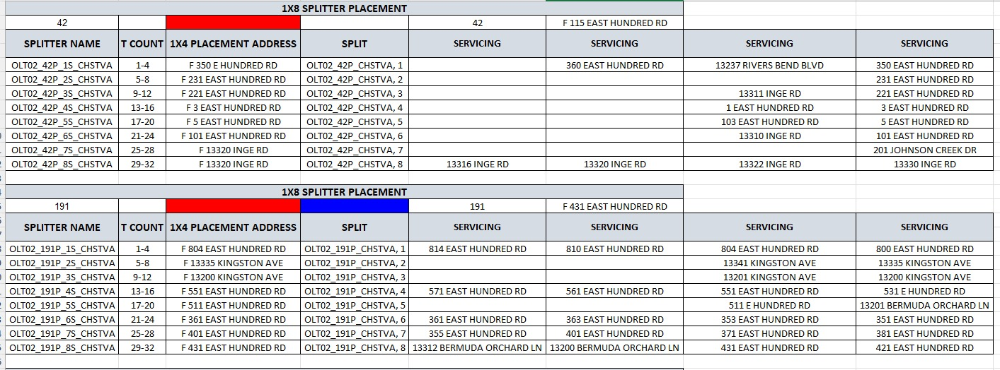
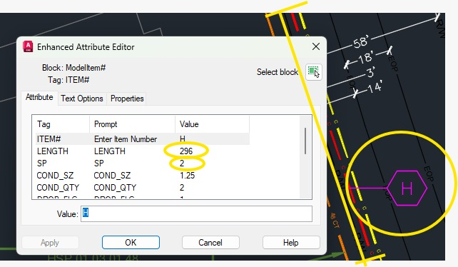
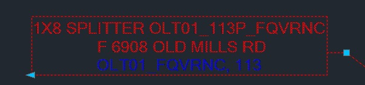
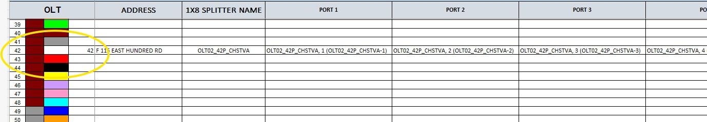
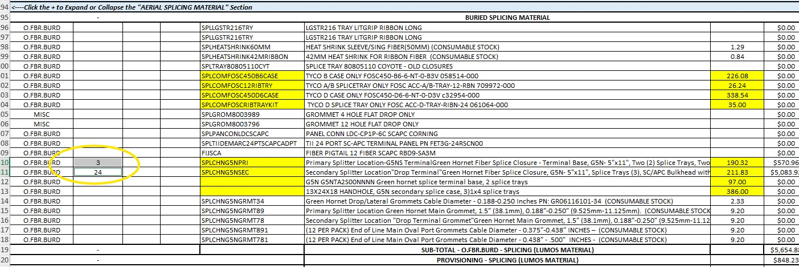

# CAD Automation Engine

A Windows desktop tool that reads fiber-optic network design drawings (AutoCAD `.dxf`) and fills in the client's multi-sheet Excel construction workbook automatically: splitter splicing tables, house counts, and labor span sheets.

Built as freelance work for a fiber-to-the-home (FTTH) design contractor. Before this tool, engineers copied the values for every job from the drawing into Excel by hand. That work was slow, and typos went straight into construction paperwork.

> **Note on data:** The client's drawings, Excel template and real outputs are proprietary, so they are not in this repo. The screenshots below show the tool's output on test data.

---

## What it does

You pick three files in the GUI: a **DXF drawing**, the client's **Excel template**, and an **output path**. The engine then:

1. Parses every block, attribute and text entity in the drawing with `ezdxf`.
2. Rebuilds the network from it: which 1x8 splitter feeds which 1x4 splitter, and which houses each 1x4 serves.
3. Writes the results into the template while preserving its formatting, colors and built-in Excel formulas.
4. Produces a separate **Cable Sequence CSV** that groups cable spans by segment, for the cable sheet.

| Output | What gets filled in |
|---|---|
| `House Count` | Every served address, de-duplicated and sorted, with unit numbers split out |
| `CABLE TO 1X8 SPLICING` | Each 1x8 splitter mapped to its row by placement number, with its 8 port assignments |
| `SPLICING 1X8 TO 1X4 SPLITS` | Each 1x4 splitter under its parent 1x8, with T-counts and the houses it serves |
| `LABOR SPAN SHEET` | Span footage, conduit size and count, and drop flags, sorted by print page and item letter, with aerial vs. buried routing |
| `*_Cable_Sequence.csv` | Cable spans assigned to their nearest segment callout, with start and end addresses |

## Architecture



The DXF is parsed **once**. The Excel export and the cable CSV then run **in parallel threads** and share the already-loaded drawing. Removing the second file read and adding the threads made the full pipeline about **5.4x faster** in testing.

```
main.py                    entry point, launches the GUI
cad_engine/
  gui.py                   CustomTkinter front end, threading, result dialogs
  parser.py                DXFParser: extraction, name normalization, geometric mapping
  exporter.py              ExcelExporter = HouseCount + Splice + CableSheet + LaborSpan renderers
  cable_assistant.py       Cable Sequence CSV (nearest-callout span assignment)
  errors.py                CADExtractionError, CableAssistantError, CADWarningInfo
docs/
  sheet-logic/             per-sheet specs: column mappings and business rules
  ERROR_HANDLING_GUIDE.md  which failures abort a run and which only warn
  WINDOWS_BUILD_INSTRUCTIONS.md
Materials/                 app icon, logo, background
```

## Engineering problems worth reading about

**1. Drafters don't type names consistently.** Splitter names are supposed to look like `OLT02_121P_SITE`, but real drawings contain missing `P` suffixes, dashes instead of underscores, stray spaces, lowercase text and no separators at all. [`normalize_splitter_name()`](cad_engine/parser.py) rebuilds the correct name from any of these. It also rejects template placeholders like `OLT#` instead of guessing what they meant.

**2. Drawing structure differs between markets.** One market's drawings use named attribute blocks. Another's use anonymous dynamic blocks (`*U…`) and plain MTEXT for callouts. The parser checks for both formats, and it falls back to assigning a block to the nearest page marker when a drafter left its print page (`SP`) field blank.

**3. Matching cable spans to segments by position.** Span blocks have no reliable link to the cable segment they belong to. The cable assistant assigns each span to its **single nearest callout** (an exclusive, Voronoi-style split, so no span is counted twice). It ignores spans more than a set distance away, and it detects the job prefix by majority vote so stray callouts from neighbouring jobs are filtered out.

**4. Knowing when *not* to automate.** An audit of a production drawing found **1,205 blocks** whose cable-size checkboxes contradicted their callout and **4,995 blocks** missing attributes. Filling the cable sheet automatically would have put wrong numbers into construction documents without anyone noticing. So that sheet is deliberately left to the engineer. The tool produces the organized Cable Sequence CSV for them to enter it from ([details](docs/sheet-logic/CABLE_SHEET_LOGIC.md)).

**5. Failing safely.** Missing core data raises a `CADExtractionError` and stops the run with a clear dialog. A partial drawing, such as a splice-only job, finishes the run, and each missing piece is reported as a `CADWarningInfo` naming the sheet that will be blank ([guide](docs/ERROR_HANDLING_GUIDE.md)).

**6. Leaving the client's spreadsheet intact.** The renderers write only to their assigned columns. They never touch the template's formula columns (`SUMIF` / `IF` material calculations), and they clear leftover rows so old data from the template can't leak into the output.

## Screenshots

| Labor span sheet | House count |
|---|---|
|  |  |

| 1x8 to 1x4 splits | CAD block attributes being read |
|---|---|
|  |  |

| A 1x8 splitter label as drawn (input) | Splitters in the 1x8 splicing sheet (output) |
|---|---|
|  |  |

| Material / cost rollup (template-preserved, untouched by the engine) |
|---|
|  |

## Running it

Requires Python 3.10+.

```bash
python -m venv .venv
source .venv/bin/activate        # Windows: .venv\Scripts\activate
pip install -r requirements.txt
python main.py
```

To run it you need a design DXF and the client's Excel template. The template must contain the sheets listed in the table above, laid out as described in [`docs/sheet-logic/`](docs/sheet-logic/). Neither file can be published.

To build the standalone Windows `.exe` with PyInstaller, see [docs/WINDOWS_BUILD_INSTRUCTIONS.md](docs/WINDOWS_BUILD_INSTRUCTIONS.md).

## Tech stack

Python 3 · [ezdxf](https://ezdxf.mozman.at/) (DXF parsing) · [openpyxl](https://openpyxl.readthedocs.io/) (template-preserving Excel writes) · [CustomTkinter](https://customtkinter.tomschimansky.com/) (GUI) · Pillow · PyInstaller (Windows packaging)

## License

Shared for portfolio review only. All rights reserved. The business rules encode a client's internal standards, so this code may not be reused without permission.
